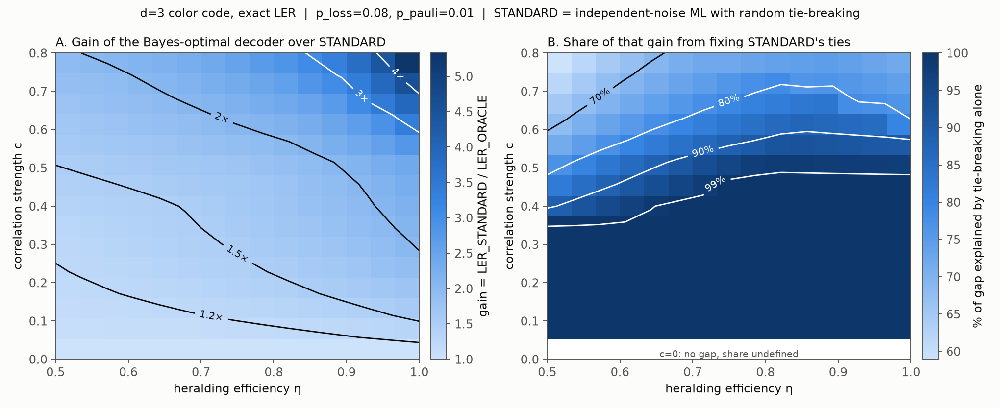
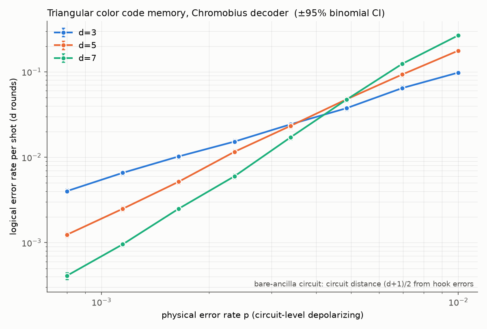

# Where does a learned decoder beat standard erasure-aware decoding of the color code?

*Draft: preliminary results and proposed thesis plan*

## Question

Neutral-atom and trapped-ion platforms convert loss and leakage into **heralded
erasures**, and standard decoders already use those heralds. So the meaningful baseline
for any "smarter" decoder is **standard erasure-aware decoding**, not loss-ignorant
decoding. The question is:

> How much does a learned or correlation-aware decoder recover over standard
> erasure-aware decoding of a color code, as heralding efficiency η degrades and loss
> mixes with Pauli and *correlated* leakage noise?

These platforms run on a millisecond clock, so decode latency is not the binding
constraint. The thesis competes on accuracy under realistic noise, and the lasting
output is a **characterization curve**: gain vs. η, correlation, loss:Pauli ratio and
distance. A specific decoder will be superseded; the curve should not be.

## Preliminary results (d=3 toy, exact)

**Model.** The [[7,1,3]] color code under phenomenological noise:

- per-qubit loss, heralded with probability η;
- Pauli flips;
- a tunable correlated-leakage term: a lost qubit flips a fixed partner with
  probability c, standing in for gate-induced leakage propagation.

The decoder sees the syndrome and the heralds. The noise distribution factorizes into
16,384 atoms, so **every logical error rate below is exact**, with no Monte-Carlo
error. Three reference decoders:

- **STANDARD:** maximum-likelihood decoding under an independent-noise model, using
  the heralds.
- **ORACLE:** Bayes-optimal given the syndrome and heralds.
- **STANDARD + best tie-break:** defined in result 2 below.

1. **On independent noise, there is nothing to gain.** STANDARD equals the ORACLE at
   c=0 for every η. Any gain has to come from correlations.

2. **With correlated leakage, the gain is real and grows toward perfect heralding.**
   ORACLE/STANDARD is 1.4–2.2× at c=0.4 (from η=0.5 to η=1), and reaches 5.3× at
   c=0.8, η=1 (figure, panel A). The gain persists at η=1 because correlated leakage crosses
   the erased/clean boundary that independent erasure decoding assumes.

3. **Most of the gain comes from a small, identifiable set of degenerate syndromes.**
   STANDARD's independent model is *exactly indifferent* between logical classes on a
   large set of inputs (about 580 of 1024 at these parameters, carrying 8–11% of the
   probability). These are events beyond what d=3 can correct, e.g. an erasure plus a
   flip on a common weight-3 logical. Breaking only those ties correctly recovers
   90–100% of the gain for c ≲ 0.4. Only at strong correlation does the optimal
   decoder overrule confident STANDARD decisions (figure, panel B).

   A methodological consequence: STANDARD's error rate depends on how its ties are
   broken. At η=0.7, c=0.4 it ranges from 0.057 to 0.119 across valid tie-break rules.
   Comparisons should report it with random tie-breaking and alongside the best
   tie-break.

4. **Learned decoders reach the Bayes ceiling, and hybrids get there with the least
   data.** I compared 8 off-the-shelf learners and 4 "hybrids" that start from STANDARD
   and learn only its failures. Flexible learners close 96–99.6% of the gap with 300k
   training shots; linear models cannot beat STANDARD. A hybrid that learns only
   STANDARD's tie-breaks closes 92–95% of the gap with ~1k shots, about 10× less data
   than the best plain learner. At strong correlation, boosted trees anchored on
   STANDARD's soft output are best.

## Circuit-level pipeline (working)

I built a triangular color-code memory circuit generator with detector annotations for
Chromobius, using stim and sinter. It shows a threshold crossing at **p ≈ 0.35–0.45%**
under circuit-level depolarizing noise, for d = 3, 5, 7.

One caveat: like stim's built-in color-code circuit, it uses bare-ancilla syndrome
extraction, so hook errors reduce the circuit distance to (d+1)/2. That is fine for
comparing decoders on a fixed circuit, but I plan to move to superdense circuits
(Gidney & Jones, arXiv:2312.08813) before making scaling claims.

## Honest scope

- The d=3 results are a **phenomenological toy with an invented leakage pairing**.
  They identify the mechanism (degenerate syndromes first, then correlation overrides)
  but do not quantify the real color code.
- The quantitative claims require the circuit-level version, with a physical
  leakage-propagation model and imperfect heralding.
- This is fault-tolerance infrastructure work. It makes no claims about cryptographic
  timelines.

## Plan

1. **Circuit-level erasure baseline (next).** Add `HERALDED_ERASE` to the generated
   circuits and implement standard erasure-aware decoding: per-shot reweighting of the
   detector error model from the heralds. Establish the honest baseline at d = 3, 5, 7.
2. **Correlated leakage and imperfect heralding.** Add a physical leakage-propagation
   model (cf. arXiv:2411.04664) and an η knob. Test whether the "degenerate syndromes
   first" structure from the toy survives at circuit level.
3. **Learned decoders anchored on the standard decoder.** Residual boosting and a GNN
   on the color-code lattice, judged against three baselines: STANDARD, STANDARD + best
   tie-break, and a learned upper bound where the ORACLE is intractable.
4. **Deliverable:** the characterization curve (gain vs. η, c, loss:Pauli ratio, d),
   with the tie-vs-correlation decomposition as the organizing lens.

## What I'd value your input on

- Whether the leakage-propagation model in step 2 matches what you see as the dominant
  correlated mechanism on current neutral-atom or ion hardware.
- Whether the tie-vs-correlation decomposition is a useful framing, or whether it is
  already standard in work I've missed.
