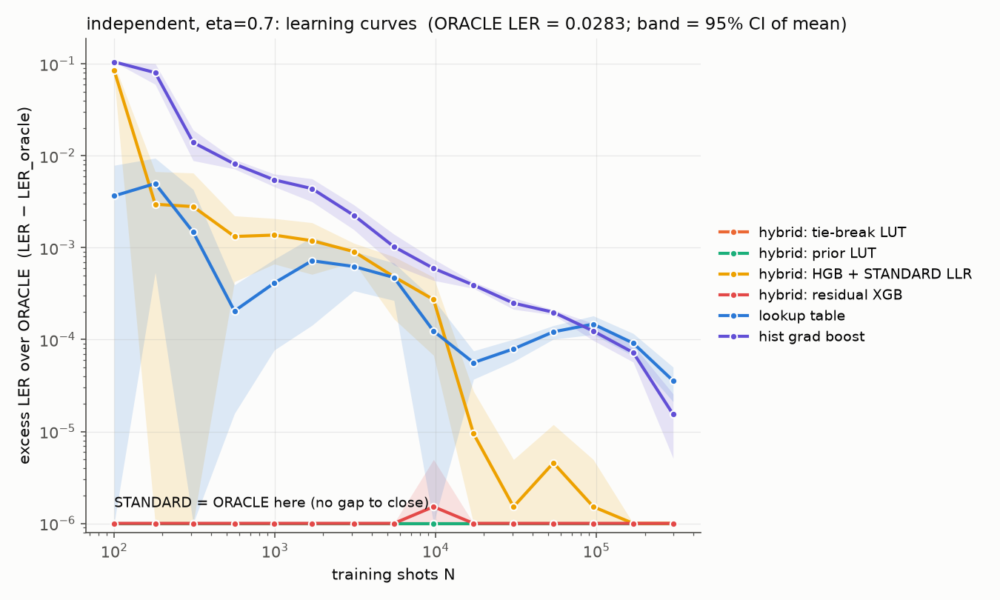
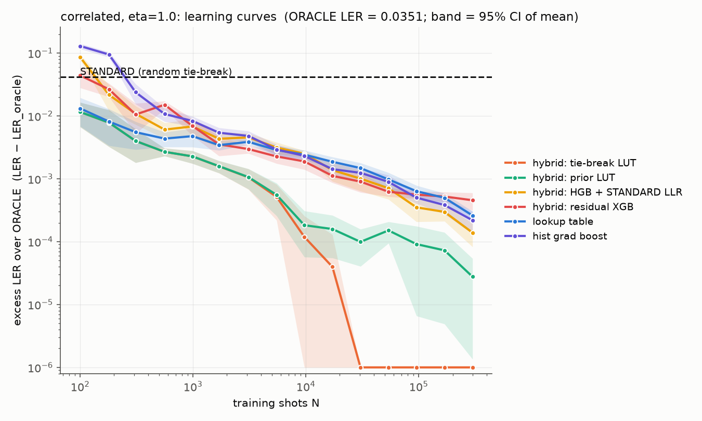
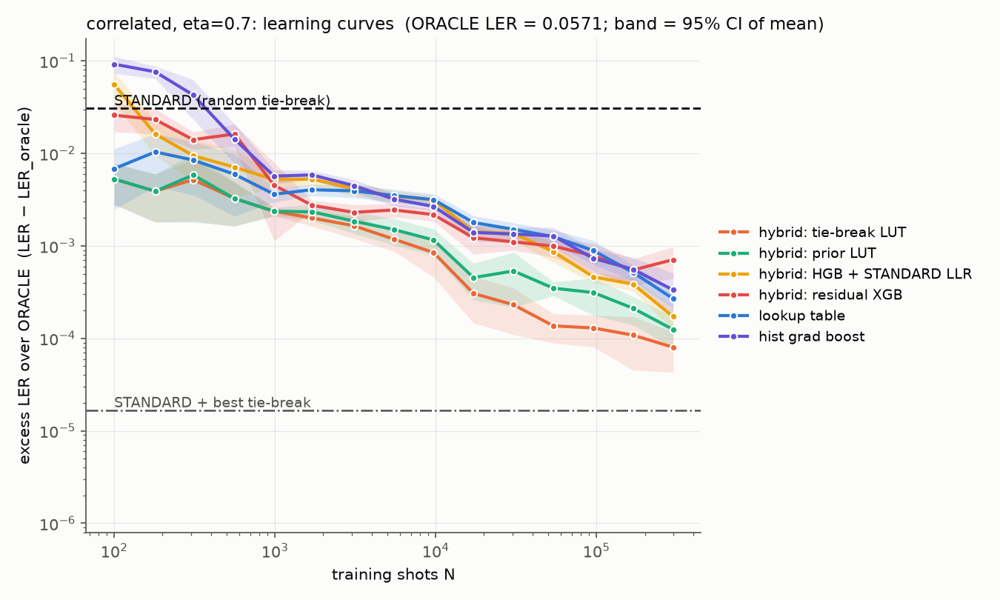
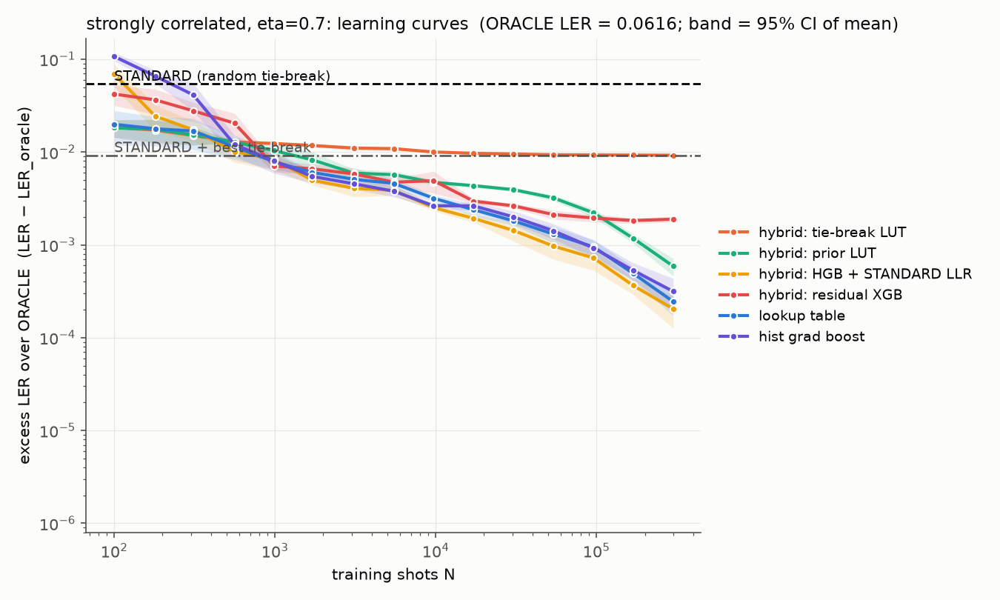
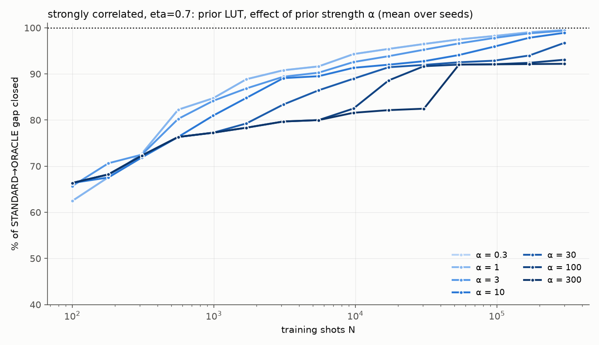

# Hybrid decoders — d=3 color code

_Generated by `model_zoo.py` on 2026-11-11. Companion to [model_zoo_report.md](model_zoo_report.md), which has the full setup and the plain learners. 4 hybrids × 15 training sizes × 10 seeds × 4 noise points, exact LER, paired training sets._

## Summary

- **A hybrid is the best decoder at nearly every training size and noise point.** In
  the "who wins" table below, a hybrid has the lowest LER in 26 of 28 cells. The
  exceptions are two mid-N cells at strong correlation. Four hybrids were tested; the
  fourth, residual XGB, was added after the first three to fix HGB + LLR's small-data
  failure (see below).

- **Moderate correlation (c = 0.4): fixing STANDARD's ties is all you need.**
  - The tie-break LUT never touches a decision STANDARD is confident about. Even so, it
    is the best decoder from ~3k shots onward, and it closes 92–95% of the gap with only
    ~1k shots.
  - The best plain learners need ~10× more data to match it. At N≈1k, the plain lookup
    table closes 88% and gradient boosting closes 80–82%.
  - At N=100, the table hybrids already close 72–83% of the gap. Plain gradient boosting
    is at about −200%: worse than STANDARD by twice the size of the gap.

- **Strong correlation (c = 0.6): the tie-break ceiling binds, and the scalable hybrid
  takes over.**
  - The tie-break LUT stops at 83.0%, exactly the tie share for this point.
  - From ~3k shots onward, **HGB + STANDARD LLR** is the best of all 11 decoders, ending
    at 99.6% of the gap.
  - The prior LUT converges to the ORACLE but lags in the middle (91% at 10k vs 95% for
    HGB + LLR). Its α=10 prior holds back the overrides this regime needs.

- **The hybrids do no harm when there is nothing to learn.** At the independent-noise
  point (STANDARD = ORACLE), both table hybrids have *zero* excess LER at every training
  size. Plain learners pay for having to relearn STANDARD from data: the lookup table
  and gradient boosting are still 0.15–0.36×10⁻⁴ above the ORACLE at 300k shots.

- **HGB + STANDARD LLR's weakness is small data.** At N=100 it is worse than STANDARD
  (−107% / −81% / −27% of the gap). It still beats plain gradient boosting (−211% /
  −201% / −97%), so the LLR feature helps. But boosting doesn't fall back on the feature
  it was given.

- **Residual XGB (boosting that *starts* at STANDARD) fixes that weakness, at a price.**
  - At N=100 it is at −6% / +16% / +22% of the gap, versus −107% / −81% / −27% for
    HGB + LLR. It has zero excess LER at the independent point.
  - But it never wins a cell. The regularization that keeps it near STANDARD with little
    data also caps it at 96.5–99% of the gap at 300k shots. HGB + LLR reaches 99.4–99.7%.
  - The fix is regularization that loosens as N grows (early stopping on a validation
    split, or min_child_weight and λ scaled with N). This is still the right design for
    d=5,7: it is the only scalable hybrid that is safe with little data.

- **Prior strength α should be chosen per regime, not fixed.**
  - α→∞ is the tie-break LUT and α→0 is the plain lookup table; the prior LUT
    interpolates between them.
  - At moderate correlation, large α (30–100) is best at every N. Holding onto STANDARD
    is correct because only its ties need fixing.
  - At strong correlation, small α (≤1) is best from N≈300 onward. α=10 trails by 3–6
    points of the gap at 1k–100k shots.
  - So the best α encodes how much correlation is present. Selecting it by
    cross-validation on the training set (no peeking at the exact LER) would get the
    best of both. The same logic applies to residual XGB's regularization strength.

**What this means for the thesis.** The decoder question splits by regime:

- Where STANDARD's degeneracies explain the whole gap, a minimal "learn the ties" fix is
  both sufficient and the most data-efficient option.
- Where correlation is strong enough to overrule confident decisions, a learned model
  anchored on STANDARD's soft output wins.

The scalable path for d=5,7 is a learned model anchored on STANDARD: residual boosting,
or a GNN that takes STANDARD's output as input. It should be judged against all three
baselines: STANDARD, STANDARD + best tie-break, and ORACLE where it can be computed.


## The four hybrids

Each hybrid starts from STANDARD (exact ML decoding under an independent-noise model that uses the heralds) and learns only where STANDARD falls short.

| hybrid | what it learns | data can override STANDARD… | limit with infinite data | needs a table? |
|---|---|---|---|---|
| **tie-break LUT** | majority vote per input, *only* on inputs where STANDARD is exactly tied | never (ties only) | STANDARD + best tie-break | yes |
| **prior LUT** (α=10) | posterior (n₁ + α·p_STD) / (n + α) per input | anywhere, once counts outweigh α pseudo-shots | ORACLE | yes |
| **HGB + STANDARD LLR** | gradient boosting on the 10 input bits plus STANDARD's log-likelihood ratio | anywhere | ORACLE (in principle) | **no** |
| **residual XGB** | boosted trees *starting from* STANDARD's LLR as the initial margin; regularized (depth 4, min_child_weight 5, λ=5) | anywhere, once trees accumulate enough evidence | ORACLE (in principle; slowed by regularization) | **no** |

Both table hybrids were checked against the exact distribution before the run. Given exact counts, tie-break LUT lands exactly on the STANDARD + best tie-break LER and prior LUT exactly on the ORACLE LER.

The plain twins used for comparison are the **lookup table** (the same as prior LUT with α→0, falling back to STANDARD only on unseen inputs) and **hist grad boost** (HGB + STANDARD LLR without the LLR feature).

## Who wins at each training size

Lowest mean LER among **all 11** decoders (8 plain + 3 hybrid) at each training size. ✱ marks a hybrid.

| point | N=100 | N=310 | N=990 | N=3,100 | N=9,700 | N=95,600 | N=300,000 |
|---|---|---|---|---|---|---|---|
| independent, eta=0.7 | ✱ tie-break LUT = ✱ prior LUT = ✱ residual XGB | ✱ tie-break LUT = ✱ prior LUT = ✱ residual XGB | ✱ tie-break LUT = ✱ prior LUT = ✱ residual XGB | ✱ tie-break LUT = ✱ prior LUT = ✱ residual XGB | ✱ tie-break LUT = ✱ prior LUT | ✱ tie-break LUT = ✱ prior LUT = ✱ residual XGB | ✱ tie-break LUT = ✱ prior LUT = ✱ HGB + STANDARD LLR = ✱ residual XGB |
| correlated, eta=1.0 | ✱ tie-break LUT = ✱ prior LUT | ✱ tie-break LUT = ✱ prior LUT | ✱ tie-break LUT = ✱ prior LUT | ✱ tie-break LUT | ✱ tie-break LUT | ✱ tie-break LUT | ✱ tie-break LUT |
| correlated, eta=0.7 | ✱ tie-break LUT = ✱ prior LUT | ✱ tie-break LUT | ✱ tie-break LUT = ✱ prior LUT | ✱ tie-break LUT | ✱ tie-break LUT | ✱ tie-break LUT | ✱ tie-break LUT |
| strongly correlated, eta=0.7 | ✱ tie-break LUT = ✱ prior LUT | logistic+pairs | random forest | ✱ HGB + STANDARD LLR | ✱ HGB + STANDARD LLR | ✱ HGB + STANDARD LLR | ✱ HGB + STANDARD LLR |

## independent, eta=0.7

η = 0.7, c = 0.0. STANDARD 0.0283 · STANDARD + best tie-break 0.0283 · ORACLE 0.0283.



No gap to close here (STANDARD = ORACLE). This point tests whether a hybrid *does harm* when there is no correlation to learn. Excess LER over ORACLE (×10⁻⁴):

| model | N=100 | N=310 | N=990 | N=3,100 | N=9,700 | N=95,600 | N=300,000 |
|---|---|---|---|---|---|---|---|
| hybrid: tie-break LUT | 0.00 | 0.00 | 0.00 | 0.00 | 0.00 | 0.00 | 0.00 |
| hybrid: prior LUT | 0.00 | 0.00 | 0.00 | 0.00 | 0.00 | 0.00 | 0.00 |
| hybrid: HGB + STANDARD LLR | 848.73 | 28.03 | 13.73 | 9.07 | 2.73 | 0.02 | 0.00 |
| hybrid: residual XGB | 0.00 | 0.00 | 0.00 | 0.00 | 0.02 | 0.00 | 0.00 |
| lookup table | 36.65 | 14.79 | 4.13 | 6.25 | 1.24 | 1.47 | 0.36 |
| hist grad boost | 1052.78 | 139.81 | 54.78 | 22.49 | 5.96 | 1.24 | 0.15 |

## correlated, eta=1.0

η = 1.0, c = 0.4. STANDARD 0.0767 · STANDARD + best tie-break 0.0351 · ORACLE 0.0351.



% of the STANDARD→ORACLE gap closed (mean ± 95% CI over seeds; negative = worse than STANDARD):

| model | N=100 | N=310 | N=990 | N=3,100 | N=9,700 | N=95,600 | N=300,000 |
|---|---|---|---|---|---|---|---|
| hybrid: tie-break LUT | 72.2 ± 11.8 | 90.4 ± 5.3 | 94.5 ± 1.3 | 97.5 ± 0.9 | 99.7 ± 0.3 | 100.0 ± 0.0 | 100.0 ± 0.0 |
| hybrid: prior LUT | 72.2 ± 11.8 | 90.4 ± 5.3 | 94.5 ± 1.3 | 97.4 ± 0.9 | 99.6 ± 0.3 | 99.8 ± 0.2 | 99.9 ± 0.1 |
| hybrid: HGB + STANDARD LLR | -107.1 ± 19.2 | 74.0 ± 8.5 | 83.7 ± 4.9 | 89.1 ± 1.8 | 94.0 ± 0.7 | 99.2 ± 0.3 | 99.7 ± 0.1 |
| hybrid: residual XGB | -5.9 ± 38.6 | 74.7 ± 12.7 | 83.4 ± 5.0 | 92.9 ± 1.1 | 95.5 ± 1.2 | 98.7 ± 0.2 | 98.9 ± 0.3 |
| lookup table | 68.4 ± 15.2 | 86.7 ± 6.3 | 88.5 ± 3.8 | 90.7 ± 0.9 | 94.2 ± 1.0 | 98.5 ± 0.4 | 99.4 ± 0.1 |
| hist grad boost | -210.9 ± 30.9 | 42.8 ± 20.1 | 80.0 ± 3.7 | 88.4 ± 2.3 | 94.4 ± 0.7 | 98.8 ± 0.2 | 99.5 ± 0.2 |

Tie-break LUT's ceiling here is **100.0%** of the gap, the share explained by STANDARD's ties.

## correlated, eta=0.7

η = 0.7, c = 0.4. STANDARD 0.0878 · STANDARD + best tie-break 0.0571 · ORACLE 0.0571.



% of the STANDARD→ORACLE gap closed (mean ± 95% CI over seeds; negative = worse than STANDARD):

| model | N=100 | N=310 | N=990 | N=3,100 | N=9,700 | N=95,600 | N=300,000 |
|---|---|---|---|---|---|---|---|
| hybrid: tie-break LUT | 82.8 ± 8.1 | 83.1 ± 10.9 | 92.3 ± 0.8 | 94.6 ± 1.5 | 97.2 ± 1.3 | 99.6 ± 0.2 | 99.7 ± 0.1 |
| hybrid: prior LUT | 82.8 ± 8.1 | 81.0 ± 13.2 | 92.3 ± 0.8 | 94.0 ± 1.6 | 96.2 ± 1.2 | 99.0 ± 0.4 | 99.6 ± 0.1 |
| hybrid: HGB + STANDARD LLR | -81.1 ± 66.7 | 69.1 ± 14.8 | 83.0 ± 2.9 | 86.5 ± 2.2 | 89.7 ± 1.2 | 98.5 ± 0.2 | 99.4 ± 0.2 |
| hybrid: residual XGB | 15.5 ± 28.7 | 54.1 ± 9.6 | 85.2 ± 11.1 | 92.5 ± 1.6 | 92.9 ± 1.1 | 97.5 ± 0.9 | 97.7 ± 0.9 |
| lookup table | 77.7 ± 14.2 | 72.4 ± 16.0 | 88.2 ± 2.1 | 87.2 ± 2.0 | 89.7 ± 1.6 | 97.1 ± 0.8 | 99.1 ± 0.2 |
| hist grad boost | -200.8 ± 63.1 | -39.7 ± 63.7 | 81.5 ± 3.1 | 85.4 ± 2.3 | 91.3 ± 0.9 | 97.6 ± 0.6 | 98.9 ± 0.6 |

Tie-break LUT's ceiling here is **99.9%** of the gap, the share explained by STANDARD's ties.

## strongly correlated, eta=0.7

η = 0.7, c = 0.6. STANDARD 0.1159 · STANDARD + best tie-break 0.0708 · ORACLE 0.0616.



% of the STANDARD→ORACLE gap closed (mean ± 95% CI over seeds; negative = worse than STANDARD):

| model | N=100 | N=310 | N=990 | N=3,100 | N=9,700 | N=95,600 | N=300,000 |
|---|---|---|---|---|---|---|---|
| hybrid: tie-break LUT | 66.4 ± 7.2 | 72.3 ± 5.7 | 77.3 ± 1.0 | 79.7 ± 1.1 | 81.6 ± 0.4 | 82.9 ± 0.1 | 83.0 ± 0.0 |
| hybrid: prior LUT | 66.4 ± 7.2 | 71.9 ± 6.4 | 81.0 ± 3.5 | 89.1 ± 1.1 | 91.3 ± 0.5 | 95.9 ± 0.4 | 98.9 ± 0.2 |
| hybrid: HGB + STANDARD LLR | -27.3 ± 33.5 | 68.1 ± 8.0 | 84.7 ± 3.5 | 92.5 ± 1.4 | 95.4 ± 0.4 | 98.7 ± 0.4 | 99.6 ± 0.1 |
| hybrid: residual XGB | 22.5 ± 19.2 | 48.8 ± 11.9 | 87.0 ± 1.8 | 89.3 ± 1.7 | 91.0 ± 2.4 | 96.4 ± 0.4 | 96.5 ± 0.2 |
| lookup table | 63.4 ± 14.7 | 69.0 ± 11.4 | 85.6 ± 2.5 | 90.6 ± 1.4 | 94.1 ± 0.5 | 98.2 ± 0.3 | 99.5 ± 0.1 |
| hist grad boost | -97.2 ± 19.8 | 23.9 ± 25.3 | 85.3 ± 3.9 | 91.6 ± 1.1 | 95.2 ± 0.3 | 98.3 ± 0.4 | 99.4 ± 0.2 |

Tie-break LUT's ceiling here is **83.0%** of the gap, the share explained by STANDARD's ties.

## Prior strength α (prior LUT)

α is how many pseudo-shots STANDARD's opinion is worth at each input. Small α trusts the data sooner; large α holds onto STANDARD longer. Same paired training sets as above; % of gap closed, mean over seeds.

**correlated, eta=1.0**

| α | N=100 | N=310 | N=990 | N=3,100 | N=9,700 | N=95,600 | N=300,000 |
|---|---|---|---|---|---|---|---|
| 0.3 | 68.4 | 86.9 | 89.4 | 91.9 | 95.6 | 98.7 | 99.4 |
| 1 | 68.4 | 86.9 | 89.4 | 91.9 | 95.6 | 98.7 | 99.4 |
| 3 | 71.0 | 90.2 | 94.1 | 96.1 | 98.1 | 99.4 | 99.7 |
| 10 | **72.2** | **90.4** | **94.5** | 97.4 | 99.6 | 99.8 | 99.9 |
| 30 | 72.2 | 90.4 | 94.5 | **97.5** | **99.7** | 100.0 | 100.0 |
| 100 | 72.2 | 90.4 | 94.5 | 97.5 | 99.7 | **100.0** | **100.0** |
| 300 | 72.2 | 90.4 | 94.5 | 97.5 | 99.7 | 100.0 | 100.0 |

**correlated, eta=0.7**

| α | N=100 | N=310 | N=990 | N=3,100 | N=9,700 | N=95,600 | N=300,000 |
|---|---|---|---|---|---|---|---|
| 0.3 | 78.1 | 75.2 | 88.8 | 88.9 | 91.5 | 97.5 | 99.2 |
| 1 | 78.1 | 75.2 | 88.8 | 88.9 | 91.5 | 97.5 | 99.2 |
| 3 | 82.7 | 76.5 | 91.4 | 92.5 | 95.1 | 98.4 | 99.5 |
| 10 | **82.8** | 81.0 | **92.3** | 94.0 | 96.2 | 99.0 | 99.6 |
| 30 | 82.8 | **83.1** | 92.3 | **94.6** | 97.0 | 99.5 | 99.7 |
| 100 | 82.8 | 83.1 | 92.3 | 94.6 | **97.2** | **99.6** | **99.7** |
| 300 | 82.8 | 83.1 | 92.3 | 94.6 | 97.2 | 99.6 | 99.7 |

**strongly correlated, eta=0.7**

| α | N=100 | N=310 | N=990 | N=3,100 | N=9,700 | N=95,600 | N=300,000 |
|---|---|---|---|---|---|---|---|
| 0.3 | 62.5 | **72.7** | **84.7** | **90.8** | **94.3** | **98.2** | **99.5** |
| 1 | 62.5 | 72.7 | 84.7 | 90.8 | 94.3 | 98.2 | 99.5 |
| 3 | 65.7 | 72.5 | 84.2 | 89.4 | 92.6 | 97.8 | 99.4 |
| 10 | **66.4** | 71.9 | 81.0 | 89.1 | 91.3 | 95.9 | 98.9 |
| 30 | 66.4 | 72.3 | 77.3 | 83.4 | 89.0 | 92.9 | 96.7 |
| 100 | 66.4 | 72.3 | 77.3 | 79.7 | 82.5 | 92.1 | 93.1 |
| 300 | 66.4 | 72.3 | 77.3 | 79.7 | 81.6 | 92.1 | 92.2 |



Bold = best α at that training size.

## Speed

| decoder | throughput (shots/s) | fit time at N=300k |
|---|---|---|
| lookup table | 3.12e+07 | 0.04s |
| hybrid: tie-break LUT | 3.08e+07 | 0.04s |
| any decoder [compiled 1024-entry LUT] | 3.05e+07 | 0.00s |
| hybrid: prior LUT | 2.83e+07 | 0.03s |
| hybrid: HGB + STANDARD LLR | 8.91e+05 | 2.00s |
| hist grad boost | 5.64e+05 | 2.79s |
| STANDARD [per-shot ML enumeration] | 5.39e+05 | 0.00s |
| hybrid: residual XGB | 4.74e+05 | 3.35s |

The table hybrids decode at lookup-table speed. HGB + STANDARD LLR is measured with STANDARD's LLR precomputed as a 1024-entry table. At d≥5 the LLR is not tabulable, so each shot also pays for one STANDARD decode.

## Reproduce

```
.venv/Scripts/python model_zoo.py --only hybrid  # rerun hybrids (~2 min), merge
.venv/Scripts/python model_zoo.py --report-only  # rebuild both reports
```
