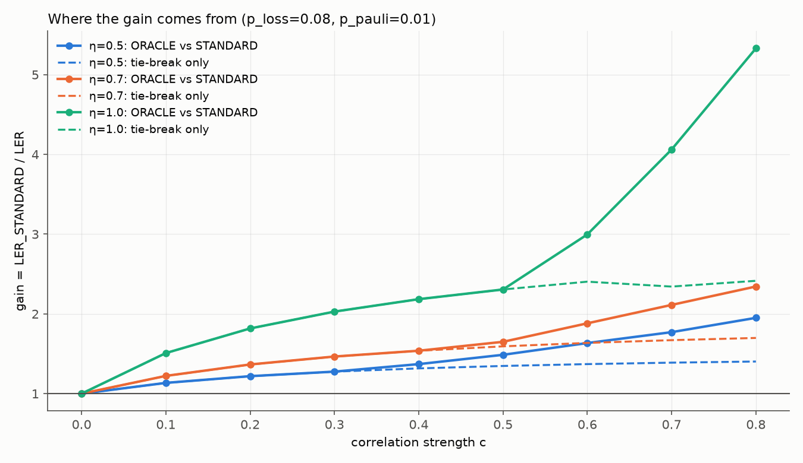
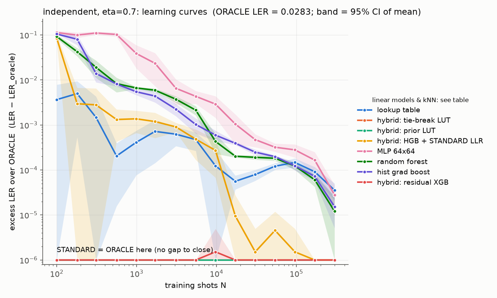
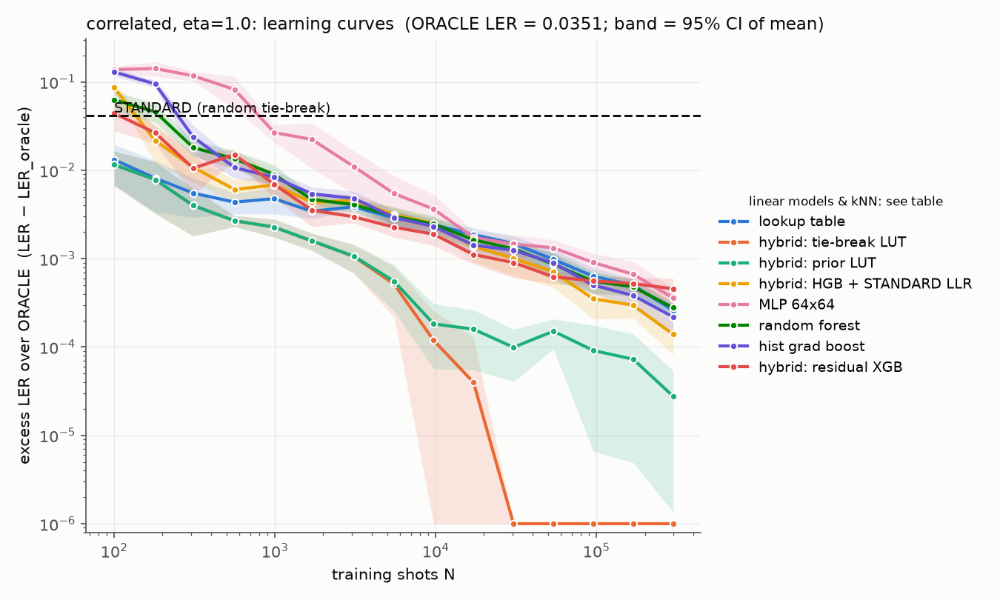
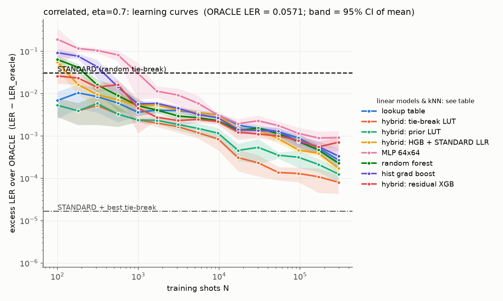
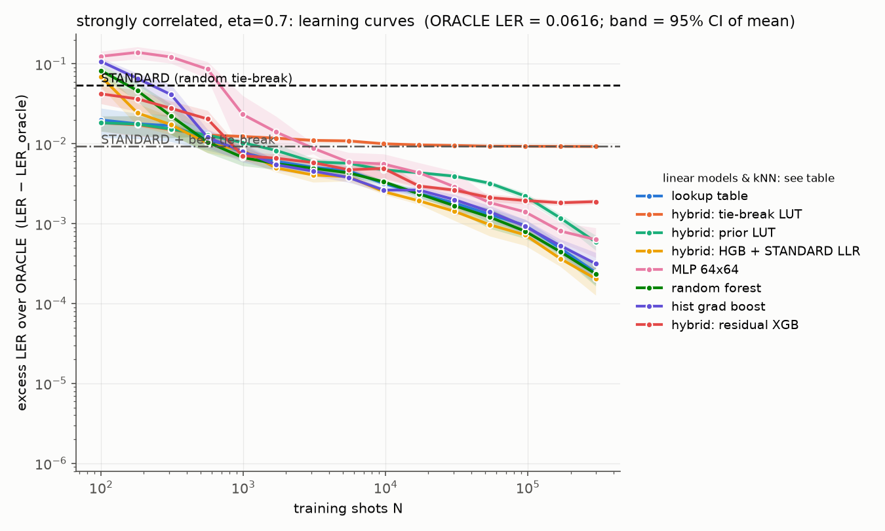
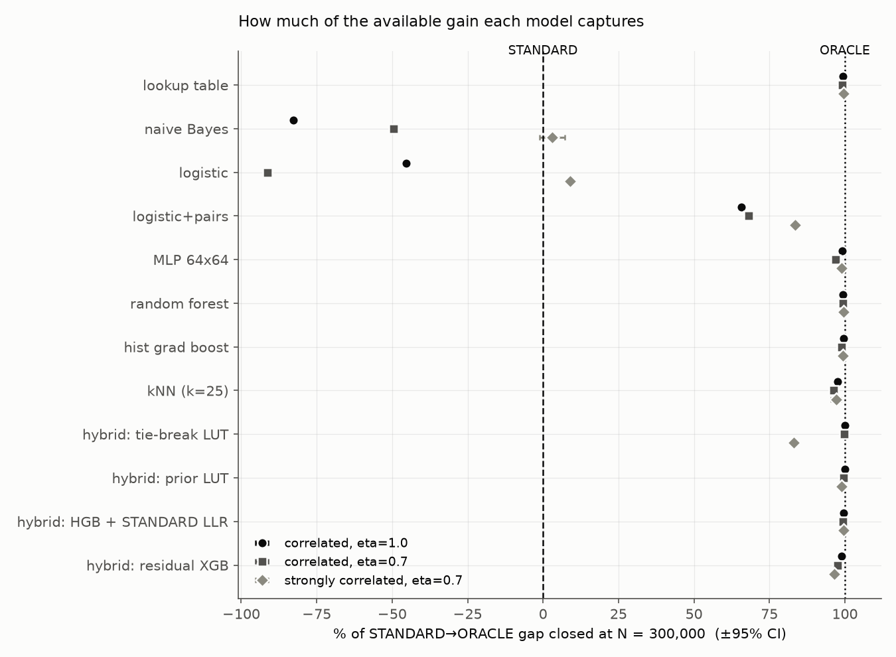
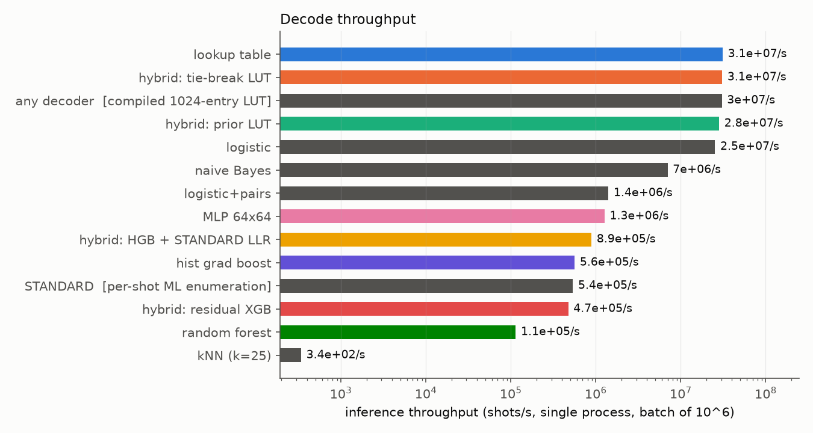

# Model zoo vs standard erasure-aware decoding — d=3 color code

_Generated by `model_zoo.py` on 2026-11-11. 12 learners × 15 training sizes × 10 seeds × 4 noise points = 7,200 trained models._

## Findings

1. **At moderate correlation, the whole ORACLE-over-STANDARD gain comes from STANDARD's exact ties.**
   STANDARD's independent-noise model is *exactly indifferent* between the two logical
   classes on ~580 of 1024 inputs (8–11% of probability mass). These are the
   capacity-exceeding d=3 events: an erasure plus a flip lying on a common weight-3
   logical. With c ≤ 0.4, breaking those ties correctly recovers 90–100% of the gap. The
   correlation-aware ORACLE never overrides a decision STANDARD was confident about. Only
   at strong correlation (c ≥ 0.6) does it start overriding confident decisions, which
   accounts for 10–40% of the gain (see the share table below).

2. **The earlier sweep's numbers hold up, but its baseline is arbitrary.**
   `heralding_correlation_sweep.py` breaks STANDARD's ties deterministically toward
   absolute class 0. At η=0.7, c=0.4 that gives STANDARD LER ≈ 0.085–0.089 (60k–400k MC
   shots), close to the random-tie-break value of 0.0878, so its reported gains are not
   materially inflated there. But the rule is arbitrary. A different but equally valid
   STANDARD implementation can land anywhere between 0.0571 (best tie-break) and roughly
   0.09. Before figures go to Girvin, the sweep should report the random-tie-break
   baseline explicitly, alongside the best-tie-break line.

3. **Flexible learners reach the Bayes ceiling; linear ones can't beat STANDARD.**
   - The lookup table, random forest, hist gradient boosting, MLP and kNN close 96–99.6% of
     the gap at N = 300k.
   - The lookup table, random forest and gradient boosting reach 90% of the gap within
     ~1.3k–10k training shots. The MLP and kNN need ~10–20k.
   - Logistic regression and naive Bayes are *worse than STANDARD* at every N. Decoding is
     a parity-like, interaction-heavy function that additive models cannot represent.
     Adding pairwise interaction features ("logistic+pairs") helps but plateaus at 65–84%
     of the gap.

4. **Speed is not a differentiator at d=3.** With 1024 possible inputs, any decoder can be
   compiled to a lookup table that runs at ~3×10⁷ shots/s. In native form the learners
   span 340 shots/s (kNN at N = 300k) to 2.5×10⁷ shots/s (logistic regression). STANDARD's
   per-shot ML enumeration runs at 5×10⁵ shots/s. Among the flexible learners, hist
   gradient boosting has the best accuracy, fit time and throughput trade-off (fit about
   3 s, about 6×10⁵ shots/s).

5. **Hybrids help most when data is scarce, and the right hybrid depends on correlation
   strength** (see "Hybrid decoders" below).
   - **Tie-break LUT** (STANDARD everywhere except its exact ties) is the most
     sample-efficient decoder at moderate correlation. It closes 92–95% of the gap with
     ~1k shots and 97–100% with ~10k, ahead of every plain learner. But it is capped at
     the tie share by construction. At c=0.6 it levels off at 83%, exactly on the
     "STANDARD + best tie-break" line. That cap is finding 1, made visible in a decoder.
   - **Prior LUT** (STANDARD's posterior as a 10-pseudo-shot prior) matches the
     tie-break LUT at small N and converges to the ORACLE everywhere (99–99.9% at 300k).
     At strong correlation, though, the prior *resists* the overrides the data calls for.
     There it trails the plain lookup table at mid N (91% vs 94% at 10k), so α trades
     small-N safety against large-N speed.
   - **HGB + STANDARD LLR** (gradient boosting with STANDARD's soft output as a feature)
     is the best large-N model at strong correlation (95% of the gap at 10k, 99.6% at
     300k). However, it is *worse than STANDARD* at N=100: gradient boosting doesn't fall
     back to the feature it was given. This is the hybrid that scales to d=5,7. The fix
     to try there is boosting *from* STANDARD's LLR as the initial margin (residual
     boosting, `base_margin` in XGBoost/LightGBM), not just next to it.
   - All hybrids decode at plain-model speed: about 3×10⁷ shots/s for the LUTs, and
     about 9×10⁵ for HGB+LLR with the LLR tabulated. At larger d the LLR costs one
     STANDARD decode per shot.

**Implication for the thesis.** The honest claim is not "a learned decoder beats
standard erasure decoding by 2×." It is narrower:

- At moderate correlation, all of the value lies in a *small, identifiable set of
  degenerate syndromes*, where correlation information decides what the independent
  model cannot.
- At strong correlation, the learned decoder also starts overruling confident STANDARD
  decisions.

The hybrid results make the same point
constructively: a decoder that only fixes STANDARD's ties gets most of the gain with very
little data, and full correlation modeling is needed only to go past that.

The circuit-level d=5,7 version should report three baselines: STANDARD (random
tie-break), STANDARD + best tie-break, and ORACLE or learned. That way the decomposition
carries over.


## Setup

- **Code / noise:** [[7,1,3]] color code, phenomenological toy from `heralding_correlation_sweep.py`: per-qubit loss (heralded w.p. η) + Pauli, plus correlated leakage (a lost qubit flips its fixed partner w.p. c).
- **Decoder input:** 3 syndrome bits + 7 herald bits (1024 possible inputs). **Output:** logical class relative to the canonical correction.
- **Exact scoring:** the noise distribution factorizes into 16,384 atoms, so every LER below is computed *exactly*, with no Monte-Carlo noise in evaluation. Error bars reflect only training-set randomness (95% CI of the mean over seeds; all models at a given (seed, N) share the same training set).
- **References:** *STANDARD* = exact ML with independent per-qubit priors given heralds. Its independent model has **exact ties** on some inputs; the honest baseline breaks them at random (expected LER). *STANDARD + best tie-break* breaks every tie the right way (what tie-breaking alone can buy). *ORACLE* = Bayes-optimal given the observables, the ceiling for any decoder.

## Reference decoders (exact)

| point | η | c | STANDARD | STANDARD + best tie | ORACLE | ceiling gain | share of gain from ties | tied inputs (prob. mass) |
|---|---|---|---|---|---|---|---|---|
| independent, eta=0.7 | 0.7 | 0.0 | 0.0283 | 0.0283 | 0.0283 | 1.00× | — | 638 (0.040) |
| correlated, eta=1.0 | 1.0 | 0.4 | 0.0767 | 0.0351 | 0.0351 | 2.18× | 100% | 578 (0.101) |
| correlated, eta=0.7 | 0.7 | 0.4 | 0.0878 | 0.0571 | 0.0571 | 1.54× | 100% | 578 (0.087) |
| strongly correlated, eta=0.7 | 0.7 | 0.6 | 0.1159 | 0.0708 | 0.0616 | 1.88× | 83% | 578 (0.114) |

## Where the gain comes from



Solid lines: full ORACLE gain over STANDARD. Dashed: gain from fixing STANDARD's tie-breaks only, without overriding any decision it is confident about. Where solid and dashed coincide, *all* of the value of modeling correlation is in resolving inputs the independent model is exactly indifferent about.

Share of the gain explained by tie-breaking at η=0.7, across the parameter grid (full grid in `results/ties.csv`):

| p_loss | p_pauli | c=0.2 | c=0.4 | c=0.6 | c=0.8 |
|---|---|---|---|---|---|
| 0.04 | 0.003 | 100% | 96% | 83% | 74% |
| 0.04 | 0.01 | 100% | 100% | 96% | 84% |
| 0.04 | 0.03 | 100% | 100% | 96% | 90% |
| 0.08 | 0.003 | 100% | 91% | 78% | 69% |
| 0.08 | 0.01 | 100% | 100% | 83% | 72% |
| 0.08 | 0.03 | 100% | 100% | 91% | 81% |
| 0.15 | 0.003 | 99% | 90% | 73% | 61% |
| 0.15 | 0.01 | 99% | 94% | 74% | 62% |
| 0.15 | 0.03 | 99% | 100% | 74% | 63% |

## Learning curves

Y-axis is **excess LER over the ORACLE** on a log scale, so every curve's distance to the Bayes ceiling is visible, including models far worse than STANDARD. Points pinned at the bottom have learned the ORACLE exactly (excess ≤ 1e-6).

### independent, eta=0.7



| model | LER at N=300,000 (±95% CI) | gain vs STANDARD | gap closed | N to close 90% of gap | best N | mean fit time at N=300,000 |
|---|---|---|---|---|---|---|
| lookup table | 0.02831 ± 0.00001 | 0.999× | — | — | 300,000 | 0.06s |
| naive Bayes | 0.07140 ± 0.00000 | 0.396× | — | — | 5,500 | 0.28s |
| logistic | 0.08762 ± 0.00000 | 0.323× | — | — | 1,700 | 0.59s |
| logistic+pairs | 0.02916 ± 0.00002 | 0.970× | — | — | 95,600 | 4.06s |
| MLP 64x64 | 0.02830 ± 0.00002 | 0.999× | — | — | 300,000 | 60.03s |
| random forest | 0.02829 ± 0.00001 | 1.000× | — | — | 300,000 | 71.65s |
| hist grad boost | 0.02829 ± 0.00001 | 0.999× | — | — | 300,000 | 15.43s |
| kNN (k=25) | 0.02835 ± 0.00002 | 0.997× | — | — | 300,000 | 6.16s |
| hybrid: tie-break LUT | 0.02827 ± 0.00000 | 1.000× | — | — | 100 | 0.09s |
| hybrid: prior LUT | 0.02827 ± 0.00000 | 1.000× | — | — | 100 | 0.09s |
| hybrid: HGB + STANDARD LLR | 0.02827 ± 0.00000 | 1.000× | — | — | 300,000 | 7.79s |
| hybrid: residual XGB | 0.02827 ± 0.00000 | 1.000× | — | — | 100 | 8.39s |

### correlated, eta=1.0



| model | LER at N=300,000 (±95% CI) | gain vs STANDARD | gap closed | N to close 90% of gap | best N | mean fit time at N=300,000 |
|---|---|---|---|---|---|---|
| lookup table | 0.03538 ± 0.00004 | 2.169× | 99.4% | 1,266 | 300,000 | 0.10s |
| naive Bayes | 0.11113 ± 0.00000 | 0.690× | -82.7% | not reached | 990 | 0.33s |
| logistic | 0.09563 ± 0.00006 | 0.802× | -45.4% | not reached | 1,700 | 0.73s |
| logistic+pairs | 0.04939 ± 0.00015 | 1.554× | 65.7% | not reached | 3,100 | 4.34s |
| MLP 64x64 | 0.03548 ± 0.00011 | 2.163× | 99.1% | 8,237 | 300,000 | 40.17s |
| random forest | 0.03540 ± 0.00005 | 2.168× | 99.3% | 2,864 | 300,000 | 86.57s |
| hist grad boost | 0.03534 ± 0.00009 | 2.171× | 99.5% | 3,774 | 300,000 | 15.16s |
| kNN (k=25) | 0.03612 ± 0.00022 | 2.124× | 97.6% | 6,649 | 95,600 | 6.93s |
| hybrid: tie-break LUT | 0.03512 ± 0.00000 | 2.185× | 100.0% | 303 | 30,500 | 0.08s |
| hybrid: prior LUT | 0.03515 ± 0.00003 | 2.183× | 99.9% | 303 | 300,000 | 0.12s |
| hybrid: HGB + STANDARD LLR | 0.03526 ± 0.00006 | 2.176× | 99.7% | 3,633 | 300,000 | 10.77s |
| hybrid: residual XGB | 0.03557 ± 0.00014 | 2.157× | 98.9% | 1,537 | 300,000 | 9.00s |

### correlated, eta=0.7



| model | LER at N=300,000 (±95% CI) | gain vs STANDARD | gap closed | N to close 90% of gap | best N | mean fit time at N=300,000 |
|---|---|---|---|---|---|---|
| lookup table | 0.05736 ± 0.00006 | 1.531× | 99.1% | 10,084 | 300,000 | 0.06s |
| naive Bayes | 0.10302 ± 0.00000 | 0.852× | -49.5% | not reached | 17,200 | 0.30s |
| logistic | 0.11585 ± 0.00002 | 0.758× | -91.3% | not reached | 560 | 0.80s |
| logistic+pairs | 0.06685 ± 0.00024 | 1.313× | 68.2% | not reached | 95,600 | 4.17s |
| MLP 64x64 | 0.05800 ± 0.00039 | 1.514× | 97.0% | 9,865 | 169,300 | 59.40s |
| random forest | 0.05731 ± 0.00005 | 1.532× | 99.3% | 2,904 | 300,000 | 66.72s |
| hist grad boost | 0.05742 ± 0.00017 | 1.529× | 98.9% | 6,357 | 300,000 | 13.67s |
| kNN (k=25) | 0.05820 ± 0.00032 | 1.509× | 96.4% | 8,491 | 300,000 | 7.20s |
| hybrid: tie-break LUT | 0.05717 ± 0.00004 | 1.536× | 99.7% | 632 | 300,000 | 0.07s |
| hybrid: prior LUT | 0.05721 ± 0.00005 | 1.535× | 99.6% | 632 | 300,000 | 0.07s |
| hybrid: HGB + STANDARD LLR | 0.05726 ± 0.00005 | 1.533× | 99.4% | 9,950 | 300,000 | 8.79s |
| hybrid: residual XGB | 0.05780 ± 0.00027 | 1.519× | 97.7% | 1,542 | 169,300 | 8.48s |

### strongly correlated, eta=0.7



| model | LER at N=300,000 (±95% CI) | gain vs STANDARD | gap closed | N to close 90% of gap | best N | mean fit time at N=300,000 |
|---|---|---|---|---|---|---|
| lookup table | 0.06185 ± 0.00007 | 1.874× | 99.5% | 2,492 | 300,000 | 0.06s |
| naive Bayes | 0.11428 ± 0.00233 | 1.014× | 3.0% | not reached | 54,000 | 0.29s |
| logistic | 0.11100 ± 0.00000 | 1.044× | 9.1% | not reached | 1,700 | 0.97s |
| logistic+pairs | 0.07052 ± 0.00015 | 1.644× | 83.6% | not reached | 990 | 4.78s |
| MLP 64x64 | 0.06223 ± 0.00026 | 1.863× | 98.8% | 10,392 | 300,000 | 62.18s |
| random forest | 0.06184 ± 0.00007 | 1.875× | 99.6% | 1,998 | 300,000 | 67.83s |
| hist grad boost | 0.06192 ± 0.00012 | 1.872× | 99.4% | 1,741 | 300,000 | 17.70s |
| kNN (k=25) | 0.06319 ± 0.00093 | 1.834× | 97.1% | 19,190 | 300,000 | 7.76s |
| hybrid: tie-break LUT | 0.07085 ± 0.00000 | 1.636× | 83.0% | not reached | 300,000 | 0.07s |
| hybrid: prior LUT | 0.06219 ± 0.00013 | 1.864× | 98.9% | 6,418 | 300,000 | 0.07s |
| hybrid: HGB + STANDARD LLR | 0.06181 ± 0.00008 | 1.876× | 99.6% | 1,580 | 300,000 | 8.37s |
| hybrid: residual XGB | 0.06349 ± 0.00013 | 1.826× | 96.5% | 3,799 | 169,300 | 8.45s |

## Hybrid decoders

Hybrids start from STANDARD and learn only where it falls short. *tie-break LUT* keeps STANDARD wherever it has a preference and learns a majority vote only on its exactly-tied inputs (ceiling = STANDARD + best tie-break). *prior LUT* is a Bayesian table with STANDARD's soft posterior as a prior worth α=10 pseudo-shots per input. *HGB + STANDARD LLR* is gradient boosting given STANDARD's log-likelihood ratio as an extra feature; it is the only hybrid that needs no table, so it is the one that carries over to d=5,7.

Percent of the STANDARD→ORACLE gap closed vs. training shots (mean over seeds; negative = worse than STANDARD):

**correlated, eta=1.0**

| model | N=100 | N=990 | N=9,700 | N=95,600 | N=300,000 |
|---|---|---|---|---|---|
| hybrid: tie-break LUT | 72.2% | 94.5% | 99.7% | 100.0% | 100.0% |
| hybrid: prior LUT | 72.2% | 94.5% | 99.6% | 99.8% | 99.9% |
| hybrid: HGB + STANDARD LLR | -107.1% | 83.7% | 94.0% | 99.2% | 99.7% |
| hybrid: residual XGB | -5.9% | 83.4% | 95.5% | 98.7% | 98.9% |
| lookup table | 68.4% | 88.5% | 94.2% | 98.5% | 99.4% |
| random forest | -50.7% | 78.5% | 94.1% | 98.7% | 99.3% |
| hist grad boost | -210.9% | 80.0% | 94.4% | 98.8% | 99.5% |

**correlated, eta=0.7**

| model | N=100 | N=990 | N=9,700 | N=95,600 | N=300,000 |
|---|---|---|---|---|---|
| hybrid: tie-break LUT | 82.8% | 92.3% | 97.2% | 99.6% | 99.7% |
| hybrid: prior LUT | 82.8% | 92.3% | 96.2% | 99.0% | 99.6% |
| hybrid: HGB + STANDARD LLR | -81.1% | 83.0% | 89.7% | 98.5% | 99.4% |
| hybrid: residual XGB | 15.5% | 85.2% | 92.9% | 97.5% | 97.7% |
| lookup table | 77.7% | 88.2% | 89.7% | 97.1% | 99.1% |
| random forest | -107.6% | 83.2% | 92.6% | 97.6% | 99.3% |
| hist grad boost | -200.8% | 81.5% | 91.3% | 97.6% | 98.9% |

**strongly correlated, eta=0.7**

| model | N=100 | N=990 | N=9,700 | N=95,600 | N=300,000 |
|---|---|---|---|---|---|
| hybrid: tie-break LUT | 66.4% | 77.3% | 81.6% | 82.9% | 83.0% |
| hybrid: prior LUT | 66.4% | 81.0% | 91.3% | 95.9% | 98.9% |
| hybrid: HGB + STANDARD LLR | -27.3% | 84.7% | 95.4% | 98.7% | 99.6% |
| hybrid: residual XGB | 22.5% | 87.0% | 91.0% | 96.4% | 96.5% |
| lookup table | 63.4% | 85.6% | 94.1% | 98.2% | 99.5% |
| random forest | -51.6% | 87.6% | 93.8% | 98.5% | 99.6% |
| hist grad boost | -97.2% | 85.3% | 95.2% | 98.3% | 99.4% |

## Gap closed, all correlated points



## Speed



| decoder | form | throughput (shots/s) | fit time at N_max (single process) |
|---|---|---|---|
| lookup table | native sklearn/numpy | 3.12e+07 | 0.04s |
| hybrid: tie-break LUT | native sklearn/numpy | 3.08e+07 | 0.04s |
| any decoder | compiled 1024-entry LUT | 3.05e+07 | 0.00s |
| hybrid: prior LUT | native sklearn/numpy | 2.83e+07 | 0.03s |
| logistic | native sklearn/numpy | 2.54e+07 | 0.25s |
| naive Bayes | native sklearn/numpy | 7.01e+06 | 0.10s |
| logistic+pairs | native sklearn/numpy | 1.41e+06 | 1.82s |
| MLP 64x64 | native sklearn/numpy | 1.27e+06 | 44.26s |
| hybrid: HGB + STANDARD LLR | native sklearn/numpy | 8.91e+05 | 2.00s |
| hist grad boost | native sklearn/numpy | 5.64e+05 | 2.79s |
| STANDARD | per-shot ML enumeration | 5.39e+05 | 0.00s |
| hybrid: residual XGB | native sklearn/numpy | 4.74e+05 | 3.35s |
| random forest | native sklearn/numpy | 1.14e+05 | 22.85s |
| kNN (k=25) | native sklearn/numpy | 340 | 1.26s |

At d=3 the input space is only 1024 points, so **every** decoder here, learned or not, can be compiled to a lookup table and run at the LUT rate. Native-form speed differences are an implementation detail at d=3; they start to matter only at larger distance, where the input space is too big to tabulate.

## Reproduce

```
.venv/Scripts/python model_zoo.py                # full run + report
.venv/Scripts/python model_zoo.py --only hybrid  # rerun just the hybrids, merge
.venv/Scripts/python model_zoo.py --report-only  # rebuild figures + this doc
```
